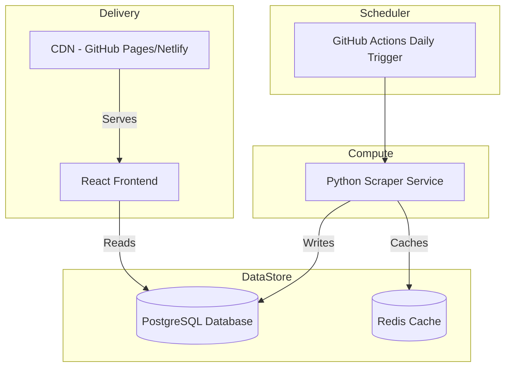

# Production Plan: Casino Bonus Scraper (200 Casinos Daily)

## Architecture for Production



## Where It Runs

| Component | Cloud Provider | Reason |
|-----------|---------------|--------|
| Scraper | AWS Fargate or Google Cloud Run | Serverless, auto-scales, pay-per-use, ideal for daily batch jobs |
| Database | AWS RDS (PostgreSQL) or Azure PostgreSQL | Managed service, automated backups, high availability |
| Cache | AWS Elasticache or Redis Labs | Fast read access for web frontend |
| CDN | GitHub Pages/Netlify/Vercel | Free, easy setup, global HTTPS, excellent for static files |
| CI/CD | GitHub Actions | Free tier, integrated with repository, easy scheduling |

## Database Design

```sql
CREATE TABLE casinos (
    id SERIAL PRIMARY KEY,
    name VARCHAR(255) NOT NULL,
    welcome_bonus TEXT,
    wagering_requirement INTEGER,
    minimum_deposit DECIMAL(10,2),
    source_url VARCHAR(500),
    scraped_at TIMESTAMP DEFAULT CURRENT_TIMESTAMP,
    UNIQUE(name, scraped_at)
);

CREATE INDEX idx_casinos_name ON casinos(name);
CREATE INDEX idx_casinos_scraped_at ON casinos(scraped_at);
```

## Daily Scraper Scheduling

- **Cron**: `0 6 * * *` (runs daily at 6 AM UTC)
- **Trigger**: GitHub Actions workflow
- **Success criteria**: 
  - All 3 (or 200) casinos scraped successfully
  - JSON data validated against schema
  - Error budget not exceeded
- **Failure detection**:
  - GitHub Actions marks workflow as failed
  - Alert via email/Slack on failure
  - Monitoring dashboard shows last successful run

## Monitoring & Alerting

### Key Metrics
- Scraper success/failure rate
- Runtime duration
- LLM parsing success rate
- Error budget consumption

### Alerts
- **Critical**: Scraper fails 2 days in a row
- **Warning**: Error budget > 50% consumed
- **Info**: Daily runtime exceeds 30 minutes

### Runbooks
- If source blocks scraper: switch to fallback source
- If LLM fails: revert to manual parsing, investigate
- If database full: cleanup old records (> 30 days)

## Backup & Recovery

### Database Backups
- **Automated**: Daily automated snapshots
- **Retention**: 30 days point-in-time recovery
- **Manual**: Weekly full export to S3/Blob storage

### Disaster Recovery
- RTO (Recovery Time Objective): 4 hours
- RPO (Recovery Point Objective): 24 hours
- Steps: Restore from last backup, re-run scraper for missing data

## Cost Estimate (Monthly)

| Component | Approximate Cost |
|-----------|-----------------|
| AWS Fargate (scraper, 200 runs/day) | $20-30 |
| AWS RDS PostgreSQL (db.t3.small) | $15-25 |
| AWS ElastiCache Redis | $15-20 |
| GitHub Actions (CI/CD) | $0-5 (free tier) |
| CDN (GitHub Pages) | $0 (free) |
| **Total** | **$50-80/month** |

## Risk Mitigation

| Risk | Probability | Impact | Mitigation |
|------|-------------|--------|-----------|
| Source blocks scraper | Medium | High | Maintain 3 alternative sources, rotate usage |
| LLM API unavailable | Low | Medium | Manual parsing fallback, cache results |
| Database downtime | Low | High | Multi-AZ deployment, read replicas |
| Error budget exhaustion | Medium | Medium | Alert at 50%, freeze non-critical features at 80% |
| Cost overruns | Low | Medium | Set budget alerts, optimize scraper runtime |

## Compliance & Policies

- **Robots.txt**: Always respected
- **Rate limiting**: Max 1 request per second per domain
- **No CAPTCHA bypass**: Scraper stops if CAPTCHA detected
- **Data privacy**: No personal user data collected
- **GDPR**: No storing of personal information